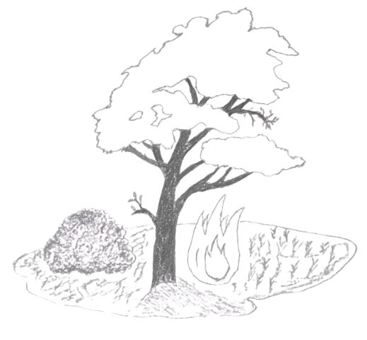
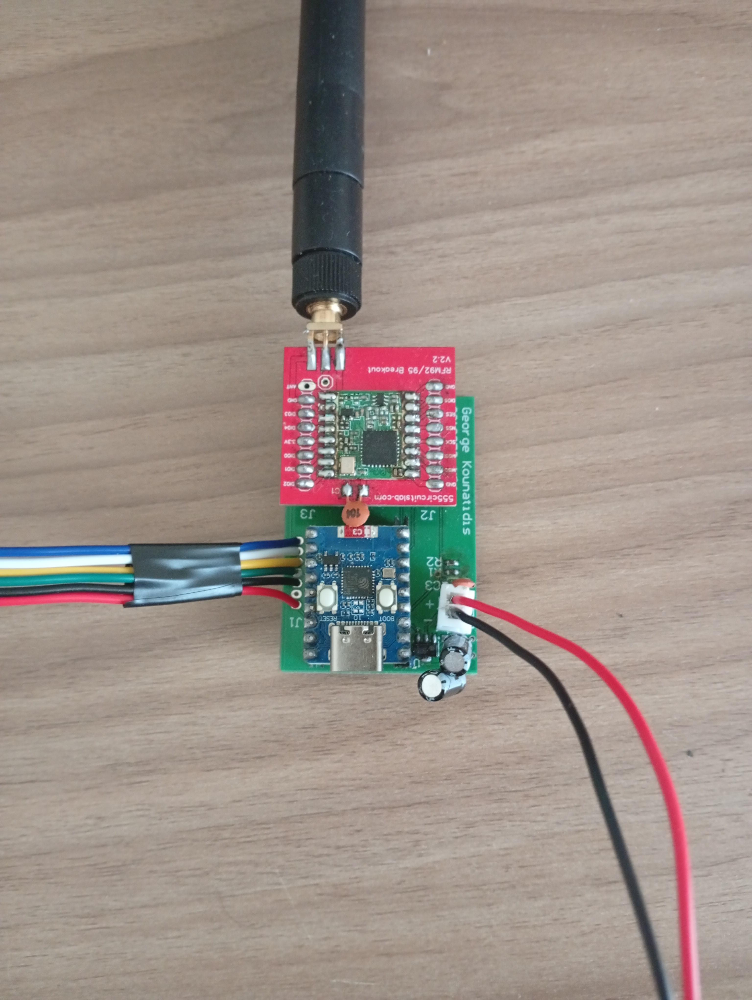

# my_Thesis

This repository contains the firmware, backend services, and experimental evaluation scripts for the diploma thesis titled **"Early detection of wildfires in remote forest areas using Multidimensional gas signatures and low-power communication"**. 

The project (v1.x.y) was conducted at the **Department of Information and Electronic Systems Engineering**, School of Engineering, **International Hellenic University (IHU)**, by **George Kounatidis**, under the supervision of Professor **Dr. Periklis Chatzimisios**

## System Overview

The system is an end-to-end, cost-effective, and energy-efficient Internet of Things (IoT) solution designed for the early detection of biomass burning in remote Mediterranean forest areas.
Rather than relying on simple static temperature thresholds, the architecture leverages **multidimensional gas signatures** (10 sequential heating steps of a Metal-Oxide / MOX sensor) combined with environmental telemetry and **Machine Learning** classifiers to minimize False Positives (FPs).

The system architecture is structured across three interconnected layers:
* **Sensing / Perception Layer:** Distributed, battery-powered sensor nodes deployed in hexagonal monitoring cells, collecting *in situ* environmental data and multidimensional gas signatures.
* **Network Layer:** Long-range, low-power wireless transmission using the **LoRaWAN** protocol (EU868 band) to an outdoor gateway, managed by **The Things Stack (TTS)**.
* **Application Layer:** Asynchronous ingestion via **MQTT** in Python, fire probability classification via trained ML models, time-series storage in **InfluxDB**, and real-time visualization and alerting via **Grafana**.

### 🎨 A "Highly Rigorous" (and Hand-Drawn) conceptual depiction of the phenomenon.

## Hardware Architecture & Custom PCB

The sensor node was engineered from the ground up for minimal quiescent current draw and resilience in outdoor forest conditions:
* **Microcontroller:** **Waveshare ESP32-C3 Zero** board (single-core 32-bit RISC-V SoC, 400 KB SRAM, 384 KB ROM, 3.3V logic). Onboard Wi-Fi and Bluetooth subsystems are explicitly disabled at boot to prevent unnecessary power draw.
* **Environmental & Gas Sensor:** **Adafruit BME688** over SPI. Measures ambient temperature, relative humidity, and barometric pressure in *forced mode*, followed by the **Standard Heating Profile 354** (10 sequential temperature steps across **100°C**, **200°C**, and **320°C**) to extract 10 gas-sensitive resistance values.
* **LoRa Transceiver:** **HopeRF RFM95W** (Semtech SX1276) mounted on an Elecrow breakout board with an SMA antenna connector, interfaced over the shared SPI bus.
* **Power Supply & Energy Management:** Single 18650 Li-ion cell (**Samsung SDI INR18650-35E**, 3.6V nominal, 3350 mAh capacity) regulated down to 3.3V by a low-dropout (LDO) linear regulator (**Microchip MCP1700**). The onboard LDO was bypassed to achieve an ultra-low quiescent current. Battery voltage is monitored via a high-impedance voltage divider (**1 MΩ** / **330 kΩ**) and an RC filter (**100 nF**, cut-off frequency **6.4 Hz**) connected to ADC1_CH1 (`GPIO1`).
* **Enclosure & Shielding:** Custom 2-layer PCB (**36.1 mm × 52.7 mm**, panelized layout) designed in **Altium Designer**. The BME688 is housed inside a custom ABS **Stevenson screen** to protect it from direct solar radiation and rain while maintaining natural ventilation.
* **LoRaWAN Gateway:** **RAK5146 PiHAT** (Semtech SX1303 baseband processor, 8 multi-SF LoRa channels, SMA 3 dBi antenna) coupled with a **Raspberry Pi 4 Model B** running RAKPiOS and UDP Packet Forwarder.

### 🏾 The proposed end device that will solve all your problems "100% Guaranteed". In this photo it does have the old regulator though.

## Software, Network & Machine Learning

* **Node Firmware (`ED1_Final_Firmare_1_3b_pcb`):** Built in Arduino IDE using `Bosch-BME68x-Library` and `MCCI LoRaWAN LMIC`. The node authenticates via **OTAA** (AES-128 encryption), bit-packs sensor readings (`pack_bits()`), and transmits unconfirmed uplinks on **EU868** using **SF8**, **125 kHz** bandwidth, **4/5** coding rate, and **12 dBm** transmission power (Time on Air: **164.35 ms**). To eliminate energy-draining OTAA re-joins upon waking, session keys are persisted in **RTC memory** before entering deep sleep for **500 s**.
* **Backend Bridge (`python_bridge`):** Python daemon subscribing to The Things Stack broker via **Paho MQTT** (`v3/+/devices/+/up`). It decodes the JSON payload, retrieves geographical coordinates from the TTS Device Registry (cached for **900 s** to avoid unnecessary API requests), and invokes the classification pipeline.
* **Machine Learning Pipeline:** The 13-dimensional feature vector `[T, RH, P, Gas_0, Gas_1, ..., Gas_9]` is scaled using `StandardScaler` (z-score) and fed into binary classifiers (`0: FIRE`, `1: NO FIRE`). Evaluated models include **Support Vector Machines (SVM with RBF kernel)**, **AdaBoost**, and **XGBoost**. The probability of fire is retrieved via `predict_proba()`.
* **Storage & Visualization:** Formatted data records (environmental telemetry, fire probability, battery percentage, RSSI, SNR, and node coordinates) are stored in **InfluxDB**. The **Grafana** dashboard displays node status on an interactive map, tracks metrics over time, and triggers automated alerts (**Probable Wildfire** at **>67%** threshold, and **Low Battery** at **<20%**) via Email.

## Experimental Evaluation & Results

### 1. Classifier Performance & Feature Analysis
The dataset (445 total observations: 145 combustion samples and 300 non-fire baseline samples) was collected across multiple controlled burn experiments involving typical Mediterranean biomass (Aleppo pine, olive tree, oriental plane, Cotinus coggygria, acacia, almond, and dry wheat straw). The node's horizontal distance from the fire ranges from 3-6m, vertical distance ranges from 1-2.5m, in some experiments NLOS conditions were present. The dataset was evaluated using an 80/20 stratified train/test split (`random_state=42`). 

Principal Component Analysis (**PCA**) demonstrated that the first two components explain **78.45%** of the total variance (`PC1 = 68.57%`, `PC2 = 9.87%`), with gas resistance channels driving PC1. Non-linear **t-SNE** projection verified clear spatial separation between FIRE and NO FIRE clusters.

| Model | Accuracy | Precision (FIRE) | Recall (FIRE) | F1-score (FIRE) |
| :--- | :--- | :--- | :--- | :--- |
| **AdaBoost** | 100% | 100% | 100% | 100% |
| **SVM (RBF)** | 98.88% | 100% | 96.55% | 98.25% |
| **XGBoost** | 100% | 100% | 100% | 100% |

### 2. Radio Propagation Field Tests
Empirical LoRaWAN propagation trials (868 MHz, SF8, 12 dBm) were conducted in dense Mediterranean forest conditions near Alonia, Pieria. Fitting the **Log-Distance Path Loss Model** yielded a path loss exponent of **$n \approx 3.02$** in the forest (compared to **$n_{LOS} = 1.72$** under Line-of-Sight conditions). Theoretical excess foliage attenuation was modeled and compared using the **ITU-R P.833-10** recommendation and the **Weissberger Modified Exponential Decay** model.

### 3. Power Consumption & Energy Autonomy
For a total duty cycle of **520 s** (**20 s** active operation averaging **24.55 mA** and **500 s** deep sleep consuming **107 μA**), the average current draw of the node is **1.048 mA**. Powered by a single 18650 cell (**3350 mAh**, accounting for 90% usable capacity), the theoretical operating autonomy reaches **2,877 hours** (**~120 days / 4 months**) without energy harvesting.
